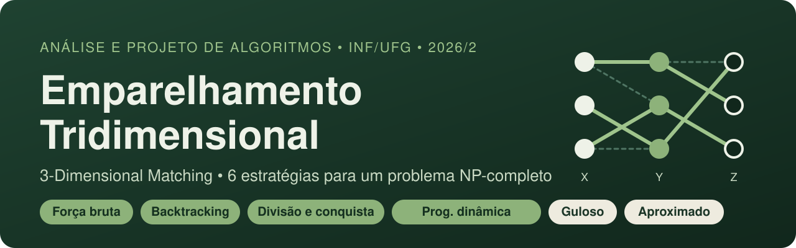
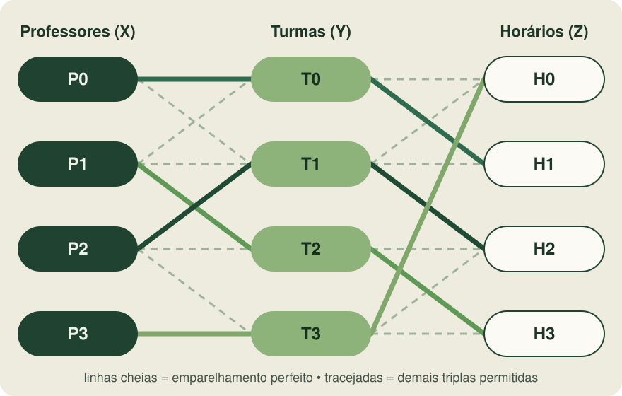
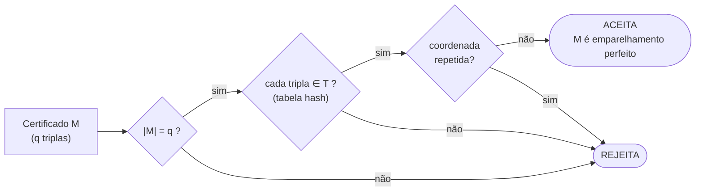
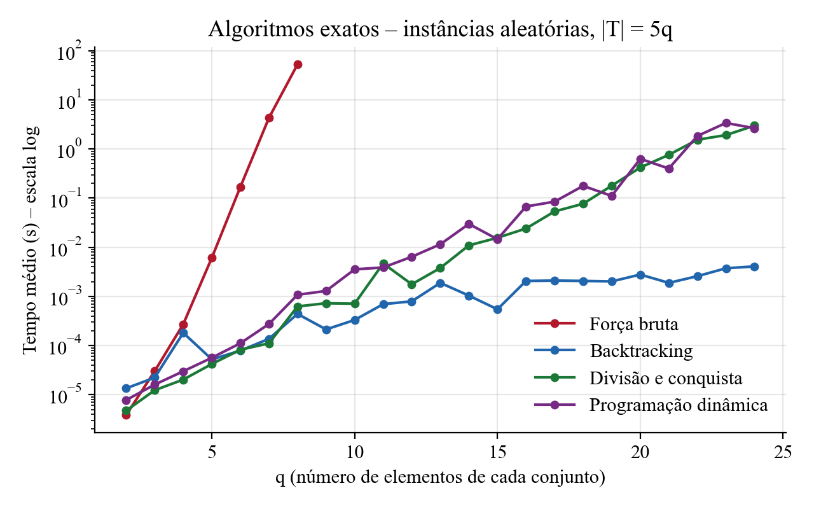
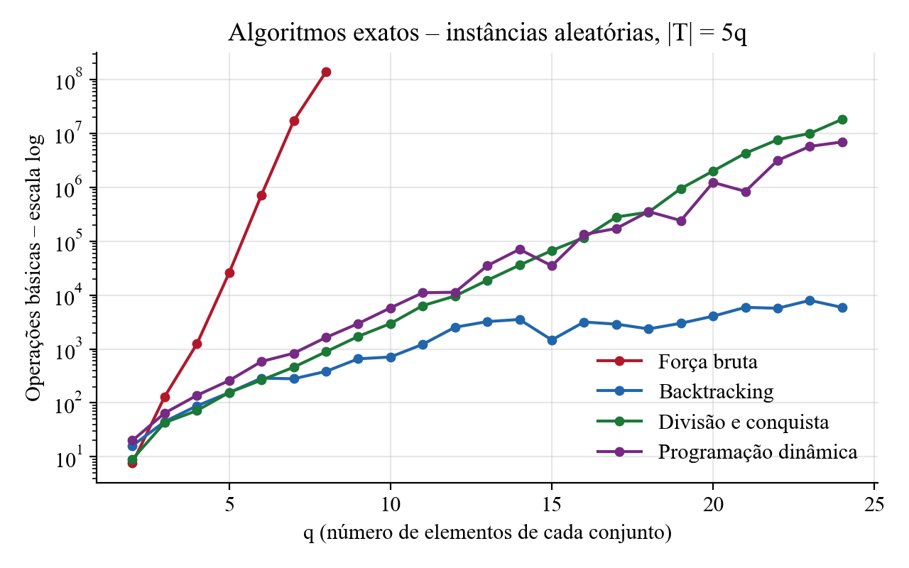
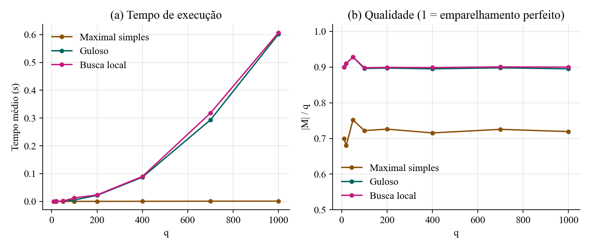
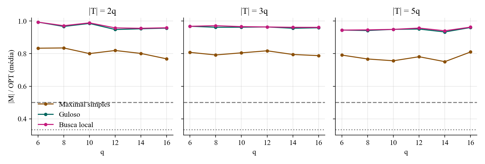

<p align="center">
  
</p>

<p align="center">
  
  
  
  
  
</p>

<p align="center">
  <b>Trabalho final de Análise e Projeto de Algoritmos (INF/UFG, 2026/2)</b><br>
  Implementação e análise de força bruta, backtracking, divisão e conquista,<br>
  programação dinâmica, algoritmo guloso e algoritmo aproximado para o <i>3-Dimensional Matching</i>.
</p>

---

## Sumário

- [O problema](#-o-problema)
- [Por que é difícil](#-por-que-é-difícil)
- [As seis estratégias](#-as-seis-estratégias)
- [Resultados](#-resultados)
- [Como executar](#-como-executar)
- [Estrutura do projeto](#-estrutura-do-projeto)
- [Referências](#-referências)
- [Autoria](#-autoria)

---

## 🧩 O problema

> **Instância:** três conjuntos disjuntos **X**, **Y** e **Z**, cada um com **q** elementos, e um conjunto de triplas **T ⊆ X × Y × Z**.
> **Pergunta:** existe **M ⊆ T** com **|M| = q** cujas triplas sejam duas a duas disjuntas, isto é, que cubra cada elemento **exatamente uma vez**?

Pense em montar uma grade horária: cada tripla `(x, y, z)` diz que *o professor x pode dar aula para a turma y no horário z*. Queremos escolher combinações de forma que nenhum professor, turma ou horário fique de fora ou apareça duas vezes.

<p align="center">
  
</p>

A instância acima está em [`exemplo.txt`](exemplo.txt). Todos os algoritmos encontram o emparelhamento perfeito `(0,0,1) (1,2,3) (2,1,2) (3,3,0)`.

---

## 🔥 Por que é difícil

| | Pares (2D) | Trios (3D) |
|---|---|---|
| Problema | Emparelhamento em grafo bipartido | Emparelhamento tridimensional |
| Complexidade | **Polinomial**: Hopcroft–Karp, `O(E·√V)` | **NP-completo**: um dos 21 problemas de Karp (1972) |

**3DM ∈ NP.** O certificado é a própria solução, e o verificador `verificar_certificado` ([`instancia.py`](instancia.py)) confere em **O(m + q)**:



**3DM é NP-difícil** por redução de 3-SAT (Garey & Johnson, 1979, §3.1.2). Portanto, a menos que P = NP, **não existe algoritmo polinomial** para ele.

---

## 🛠️ As seis estratégias

| Estratégia | Arquivo | Ideia central | Tempo (pior caso) | Espaço |
|---|---|---|---|---|
| Força bruta | [`forca_bruta.py`](forca_bruta.py) | Testa todas as combinações de q triplas | `O(C(m,q)·q)` | `O(q)` |
| Backtracking | [`backtracking.py`](backtracking.py) | MRV dinâmico + verificação adiante | `O(m^(q+1)/q!)` | `O(q·m)` |
| Divisão e conquista | [`divisao_conquista.py`](divisao_conquista.py) | *Meet-in-the-middle*: perfis (A, B) por metade de X | `O(q·D^(q/2))` | `O(q·D^(q/2))` |
| Programação dinâmica | [`prog_dinamica.py`](prog_dinamica.py) | Estados (A ⊆ Y, B ⊆ Z) em máscaras de bits | `O(D·4^q/√q)` | `O(C(2q,q))` |
| Guloso | [`guloso.py`](guloso.py) | Tripla com elementos mais restritos primeiro | `O(q·m)` | `O(m+q)` |
| Aproximado | [`aproximado.py`](aproximado.py) | Maximal (≥ OPT/3) + busca local 1→2 (≥ OPT/2) | `O(q·m²)` | `O(m+q)` |

<sub>q = elementos por conjunto · m = número de triplas · D = maior número de triplas que contém um mesmo elemento de X</sub>

Os quatro primeiros são **exatos** (sempre acertam, custo exponencial). Os dois últimos são **polinomiais** (rápidos, mas sem garantia de achar o emparelhamento perfeito). Todos contam a mesma **operação básica**, *examinar uma tripla e testar compatibilidade*, por meio de [`contador.py`](contador.py), o que torna as contagens comparáveis.

---

## 📊 Resultados

Intel Core i7-1165G7 · Python 3.10 · média de 5 instâncias por ponto · sementes fixas (reprodutível).

### Algoritmos exatos

<p align="center">
  
  
</p>

| q | Força bruta | Backtracking | Divisão e conquista | Prog. dinâmica |
|---:|---:|---:|---:|---:|
| 6 | 170 ms | 0,08 ms | 0,08 ms | 0,11 ms |
| 8 | **53 s** | 0,44 ms | 0,62 ms | 1,08 ms |
| 16 | — | 2,1 ms | 24 ms | 68 ms |
| 24 | — | **4,1 ms** | 3,0 s | 2,7 s |

- 🐢 **Força bruta**: inviável a partir de q = 8, com crescimento de cerca de ×12 por unidade de q.
- ⚡ **Backtracking**: o mais rápido, mais de **120 mil vezes** mais rápido que a força bruta em q = 8.
- 🧠 **Divisão e conquista / PD**: exponenciais, mas com fator de cerca de 1,5 por unidade de q, pois reaproveitam estados.
- ✅ **760 execuções exatas** com respostas idênticas, todas confirmadas pelo verificador.

### Guloso e aproximados

<p align="center">
  
  
</p>

| Heurística | Cobertura em q = 1.000 | Tempo | Razão média \|M\|/OPT | Garantia teórica |
|---|---:|---:|---:|---:|
| Maximal simples | 72% | 1 ms | ≈ 0,79 | ≥ 1/3 |
| Guloso | 89,5% | 0,60 s | ≈ 0,96 | ≥ 1/3 |
| Busca local | 90,0% | 0,61 s | ≈ 0,96 | ≥ 1/2 |

> ⚠️ Nenhuma heurística encontrou o emparelhamento perfeito plantado com q ≥ 10. Para a versão de decisão, teriam respondido “não” quando a resposta certa era “sim”.

---

## 🚀 Como executar

```bash
git clone https://github.com/AlanyLourenco/emparelhamento-tridimensional-3dm.git
cd emparelhamento-tridimensional-3dm
pip install -r requirements.txt     # só matplotlib, usado apenas nos gráficos

python testes.py                    # corretude: 404 instâncias
python main.py exemplo.txt          # todos os algoritmos sobre o exemplo
python main.py exemplo.txt guloso   # um algoritmo específico
python benchmark.py --rapido        # experimentos curtos
python benchmark.py                 # experimentos completos (~10 min)
```

Saída resumida de `python main.py exemplo.txt` (sem os tempos):

```text
Instância: q = 4, |T| = 10

forca_bruta            SIM      ops =   110
backtracking           SIM      ops =    40
divisao_conquista      SIM      ops =    23
programacao_dinamica   SIM      ops =    16
maximal_simples        SIM      ops =    10
guloso                 SIM      ops =    40
busca_local            SIM      ops =    40
```

**Formato da instância:** primeira linha `q m`, depois `m` linhas `x y z` com `0 ≤ x, y, z < q`. Linhas iniciadas por `#` são comentários.

---

## 📁 Estrutura do projeto

```text
.
├── instancia.py          # representação, geradores, leitura de arquivo e verificador (prova de NP)
├── contador.py           # contador de operações básicas
├── forca_bruta.py        # 1. força bruta
├── backtracking.py       # 2. backtracking (+ branch-and-bound para o ótimo)
├── divisao_conquista.py  # 3. divisão e conquista (meet-in-the-middle)
├── prog_dinamica.py      # 4. programação dinâmica sobre subconjuntos
├── guloso.py             # 5. algoritmo guloso
├── aproximado.py         # 6. maximal simples e busca local
├── main.py               # executa os algoritmos sobre um arquivo
├── testes.py             # testes de corretude
├── benchmark.py          # experimentos: CSV + gráficos
├── exemplo.txt           # instância professor × turma × horário
├── resultados/           # CSVs, gráficos e log dos experimentos
└── docs/                 # imagens deste README
```

---

## 📚 Referências

- CORMEN, T. H. et al. *Introduction to Algorithms*. 3. ed. MIT Press, 2009.
- GAREY, M. R.; JOHNSON, D. S. *Computers and Intractability: A Guide to the Theory of NP-Completeness*. W. H. Freeman, 1979.
- KARP, R. M. Reducibility among combinatorial problems. In: *Complexity of Computer Computations*. Plenum, 1972. p. 85–103.
- HOROWITZ, E.; SAHNI, S. Computing partitions with applications to the knapsack problem. *Journal of the ACM*, v. 21, n. 2, 1974.
- HURKENS, C. A. J.; SCHRIJVER, A. On the size of systems of sets every t of which have an SDR... *SIAM J. Discrete Math.*, v. 2, n. 1, 1989.
- KLEINBERG, J.; TARDOS, É. *Algorithm Design*. Pearson, 2006.
- ZIVIANI, N. *Projeto de Algoritmos com implementações em Java e C++*. Cengage, 2006.

---

## 👩‍💻 Autoria

Trabalho desenvolvido em grupo para a disciplina **Análise e Projeto de Algoritmos**, Instituto de Informática, Universidade Federal de Goiás, 2026/2.

- **Alany Gabriely Lourenço da Silva** · [@AlanyLourenco](https://github.com/AlanyLourenco)
- **Thais Lima Rodrigues da Cunha**

<p align="center"><sub>Distribuído sob a licença MIT. Veja <a href="LICENSE">LICENSE</a>.</sub></p>
